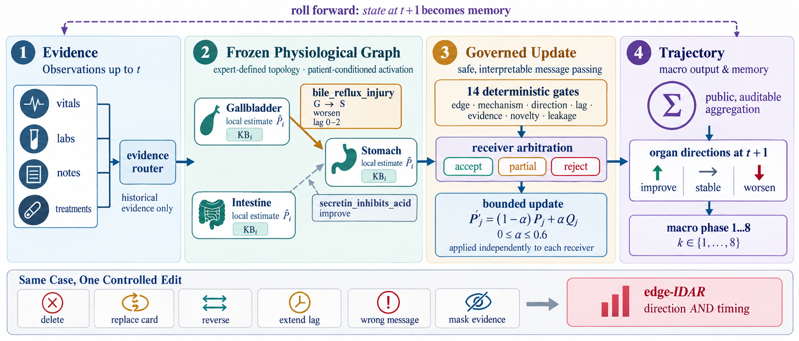

# PhysioCircuit

**Physiology as Topology: Intervenable Organ Graphs for Longitudinal Patient Forecasting**

<p align="center">
  <a href="https://arxiv.org/pdf/2610.33022">Paper</a> |
  <a href="https://katherineg11.github.io/physiocircuit_site/">Project Website</a>
</p>

<p align="center">
  
</p>

<p align="center">
  <a href="#quick-start">Quick start</a> |
  <a href="#benchmark">Benchmark</a> |
  <a href="code/README.md">Documentation</a> |
  <a href="docs/REPRODUCIBILITY.md">Reproducibility</a> |
  <a href="#citation">Citation</a>
</p>

PhysioCircuit is a multi-agent LLM system for longitudinal patient forecasting. Each organ is an agent with an inspectable knowledge base, and each physiological relation is an editable mechanism card. An expert-defined organ graph stays fixed during inference, so named mechanisms can be inspected, deleted, reversed, replaced, or delayed.

The repository contains the configuration-only inference engine, mechanism cards and organ graphs, the synthetic **PhysioCircuit-Bench**, validation scripts, replay records, and unit tests. The accompanying manuscript is by Xinru Liang, College of AI, Tsinghua University.

> **Research artifact.** API-backed runs require an OpenAI-compatible provider and may vary across providers. Tests, validators, benchmark files, and replay records run without API credentials.

## Highlights

- **Physiology as topology:** organ nodes and named mechanism edges are explicit configuration.
- **Intervenable inference:** edge deletion, direction reversal, card replacement, lag extension, message injection, and source masking are supported.
- **Three physiological systems:** digestive, pneumonia, and cardiovascular-sepsis, with 120 cases per system, 480 treatment events per system, and mechanism counterfactual pairs.
- **Reproducible controls:** deterministic gates, bounded updates, fixed public aggregation, seeded cases, and audit manifests.
- **Clinical-data boundary:** MIMIC-IV is imported only from the user's own licensed archive and is not redistributed here.

## Overview

<p align="center">
  
</p>

The same patient case can produce different trajectories when one named mechanism is edited. This is the central evaluation interface: hold the case and model fixed, change one mechanism, and score the affected organ's direction and lag.

## Repository structure

```text
assets/        README figures
code/          Python package, configs, experiment CLI, and tests
dataset_pg/    Synthetic PhysioCircuit-Bench cases and scoring records
docs/          Reproducibility and data provenance notes
```

## Quick start

PowerShell:

```powershell
python -m venv .venv
.\.venv\Scripts\Activate.ps1
pip install -r requirements.txt

cd code
python -m unittest discover -s tests -q
python -m physiograph validate --config physiograph/configs/paper.json
python -m physiograph.paper_data audit
```

The validator checks public cases, mechanism cards, graphs, counts, and prompt-safety constraints. The audit recomputes the shipped benchmark summaries. Neither command calls an external model.

## Run an experiment

From the repository root, copy `.env.example` to `.env` and set credentials for the provider selected in the config. The client reads this root-level `.env`. Never commit `.env` or API keys.

```powershell
python -m physiograph run --config physiograph/configs/paper.json --output runs/main --suite main --runs 0,1,2
python -m physiograph score --run-dir runs/main/digestive --gold runs/paper_data/digestive/gold.jsonl
```

Use `--dry-run` to inspect a planned API run without making requests. The complete CLI, configuration schema, intervention protocol, replay command, and output layout are documented in [code/README.md](code/README.md).

## Final results

The final manuscript reports direction accuracy of **91.3% / 87.8% / 89.0%** on digestive, pneumonia, and cardiovascular-sepsis. On the digestive semantic intervention suite, the expert graph reaches **92.7% edge-IDAR**. Retrospective validation uses 600 ICU admissions; raw MIMIC-IV data is not redistributed.

## Benchmark

PhysioCircuit-Bench is a **synthetic** mechanism-controlled benchmark. It covers digestive, pneumonia, and cardiovascular-sepsis systems, with 120 cases per system, 480 treatment events per system, and controlled mechanism interventions.

<p align="center">
  
</p>

Start with:

- [Benchmark overview](dataset_pg/README.md)
- [Case strata and examples](dataset_pg/CASES.md)
- [Reproducibility notes](docs/REPRODUCIBILITY.md)

The benchmark must not be described as real clinical data.

## MIMIC-IV retrospective validation

Raw MIMIC-IV data is not redistributed. If you have an approved copy under the relevant data-use agreement, import retrospective ICU trajectories with:

```powershell
python -m physiograph.import_mimiciv --zip path\to\mimic-iv-clinical-database-demo-2.0.1.zip --output runs/mimiciv_physiocircuit --n 600
```

These labels are computed retrospectively from later observations; they are not synthetic truth labels. See [docs/REPRODUCIBILITY.md](docs/REPRODUCIBILITY.md).

## Citation

See the BibTeX entry below for citation metadata.

```bibtex
@article{physiocircuit,
  title   = {Physiology as Topology: Intervenable Organ Graphs for Longitudinal Patient Forecasting},
  author  = {Liang, Xinru},
  journal = {arXiv preprint},
  eprint  = {}
% Code and benchmark: https://github.com/KatherineG11/physiocircuit
}
```

## License

Code is released under the [MIT License](LICENSE). The license does not grant permission to redistribute MIMIC-IV, MIMIC, or other third-party clinical data.
